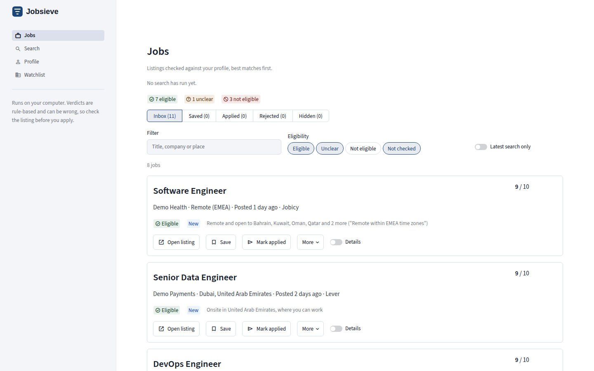
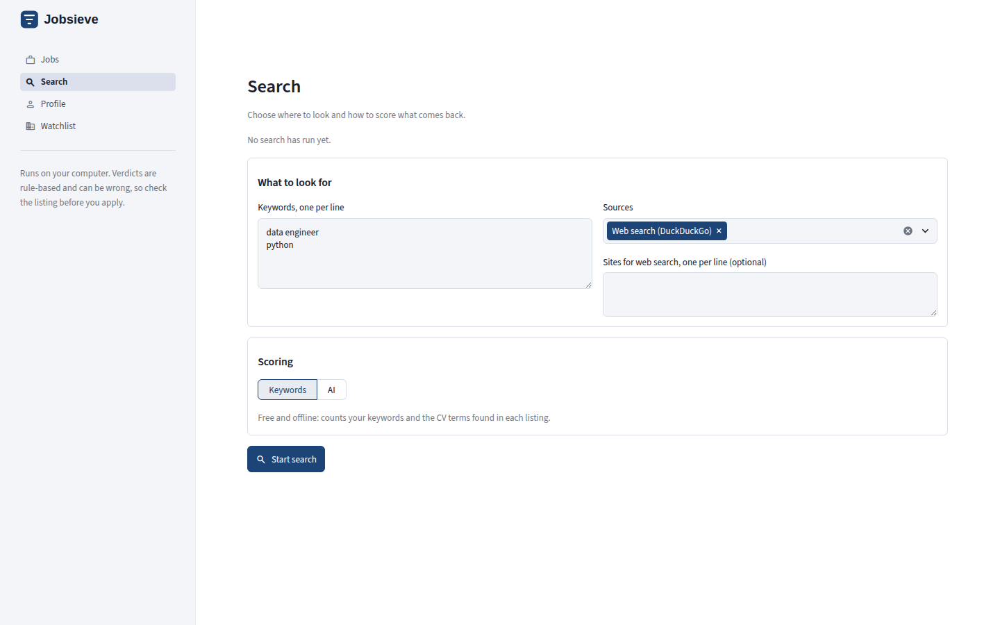

# Jobsieve


**Find the jobs you can actually apply for from where you live.** Jobsieve is a free, self-hosted job search. It collects listings from job feeds, company career boards and pages you save, checks every one against your country and work rights, and tells you which are **eligible**, **unclear** or **not eligible**, with the reason in plain words. Then it helps you keep track and apply. It was built for people searching from outside the US and the EU, such as the Gulf and MENA, where most job tools quietly show you jobs you cannot take.

Built it for myself while job hunting. It found the job. Now it is open for you.



## Why this one

- **It answers "can I apply?"** Remote only for the US, on-site abroad with no visa, clearance required: each job gets a verdict and the reasons, and anything it is unsure about says "unclear". Nothing is hidden or deleted. [How verdicts work, and how accurate they are](https://github.com/firaslamouchi21/jobsieve/blob/main/docs/eligibility.md).
- **It reaches past the usual feeds.** Remote job feeds, the career boards of companies you watch (Greenhouse, Lever, Ashby, SmartRecruiters), pages you list, and a browser extension that saves the job page you are looking at, on any site.
- **Your data stays yours.** Everything lands in a local SQLite file. No accounts, no telemetry. [What can leave your machine, and when](https://github.com/firaslamouchi21/jobsieve/blob/main/docs/privacy.md).
- **AI is optional, and any model works.** Use Groq, Gemini, Anthropic, OpenAI, or a local model through Ollama or LM Studio, or run free in Lite Mode with no key. Draft CV tweaks and a cover letter for a job, without invented experience.
- **Run it your way.** `jobsieve start` runs the dashboard and API with no Docker, or use Docker Compose. Everything the dashboard does is also a REST endpoint, a CLI command and an MCP tool for AI agents.

## What you get

- A profile (where you live, where you can work, visa needs, pay floor, dealbreakers) that every job is checked against
- Jobs ordered eligible first, with freshness (posted, closing, closed) and duplicates across sources merged
- Save, apply, hide and notes for every job, plus a daily digest by email, Slack, Discord, Telegram or webhook
- Search the web, or pull from Remote OK, Remotive, Arbeitnow, Himalayas, Jobicy, Working Nomads and your watchlist of companies
- Every job scored 0-10 (AI or Lite Mode), exports as JSON or CSV



## How to run it

### Option A: Docker (full stack)

You need Docker Engine 24+ or Docker Desktop, and about 2 GB of RAM (4 GB recommended).

```bash
cp .env.example .env
docker compose up --build
```

- **scraper** (REST API) at `http://localhost:8000`
- **UI** at `http://localhost:8501`

Edit `.env` first if you have AI keys. Without any, Lite Mode works fine. The optional n8n automation engine lives under a separate profile: `docker compose --profile automation up`.

Then open `http://localhost:8501`, paste your CV, add keywords such as `senior python remote`, pick a provider (or stay in Lite Mode) and hit Start.

### Option B: Python package

The base install is small (requests, BeautifulSoup, ddgs) and gives you the CLI and all sources. Add extras for the rest:

| Install | Adds |
| --- | --- |
| `pip install jobsieve` | CLI, sources, SQLite, keyword scoring |
| `pip install "jobsieve[ai]"` | AI scoring with Anthropic (Groq and Gemini need no extra) |
| `pip install "jobsieve[api]"` | REST API (FastAPI, uvicorn) |
| `pip install "jobsieve[ui]"` | Streamlit dashboard |
| `pip install "jobsieve[browser]"` | Playwright, for fetching full pages |
| `pip install "jobsieve[mcp]"` | MCP server for AI agents |
| `pip install "jobsieve[all]"` | everything above |

```bash
pip install jobsieve
jobsieve run --lite --sources remoteok remotive arbeitnow himalayas jobicy workingnomads --keywords "python developer" --cv-file my_cv.txt
jobsieve export --format csv --out jobs.csv
```

Useful flags for `run`: `--sources` (see below), `--sites` (domains for web search), `--keywords`, `--cv-file`, `--lite`, `--provider groq|anthropic|gemini`. Keys come from the environment (`GROQ_API_KEY`, `ANTHROPIC_API_KEY`, `GEMINI_API_KEY`) or flags. If another run is already in progress the command says so and exits with code 1.

With the extras installed:

```bash
python -m uvicorn jobsieve.api:api --port 8000
jobsieve start
```

Fetching full job pages with a headless browser needs `[browser]` and `playwright install chromium`. Without it, set `USE_PLAYWRIGHT=false` and the scraper uses plain HTTP requests.

Works on Python 3.10 to 3.12. Tested on Linux and in Docker; macOS and Windows have not been tested natively, so use Docker there.

### No Docker: one command

With `pip install "jobsieve[api,ui]"`, run `jobsieve start`. It starts the API and the dashboard together on your machine (`http://127.0.0.1:8501`) and stops both when you press Ctrl+C. `jobsieve start --demo` uses made-up demo jobs in `./demo-data`, so you can look around or take screenshots without touching your own data. The first time you open the dashboard it shows three steps: save your profile, add companies (there is a `gulf-mena` starter list of employers whose boards answered when it was made; `jobsieve watch starter gulf-mena`), and press Start.

### Fetch listings without any server (for scripts and AI agents)

```bash
jobsieve fetch --source remoteok remotive arbeitnow --keyword python "remote backend" --limit 20 --json
```

This downloads the feeds (cached on disk, see below), keeps listings matching your keywords, saves them to SQLite and prints a JSON array on stdout. Each record has `title`, `company`, `location`, `remote`, `salary`, `posted_at`, `url`, `description`, `source`, `attribution`, `job_hash` and `is_new`. Messages and errors go to stderr, so stdout is always valid JSON. Add `--no-store` to skip the database. Exit code: 0 on success (even if one source failed; its error is on stderr), 2 for an unknown source, 3 if every source failed. `jobsieve sources` lists the available sources. A caller that scores listings itself can write the result back with `jobsieve.db.set_score(job_hash, score, reasoning)`.

### Save a job from any website (browser extension)

The `extension/` folder holds a small browser extension. Open a job page on any site, click the button, and the job is saved to your own Jobsieve with the same eligibility check. It reads a page only when you click, sends it only to your local Jobsieve, and never fetches pages itself. See [extension/README.md](https://github.com/firaslamouchi21/jobsieve/blob/main/extension/README.md) for what it can read and how to install it.

### Let an AI agent use it (MCP)

`pip install "jobsieve[mcp]"`, then add `jobsieve mcp` to your agent as a stdio MCP server (for Claude Code: `claude mcp add jobsieve -- jobsieve mcp`; in other clients, a server with the command `jobsieve` and the argument `mcp`). Set `DATA_DIR` in its environment if your data lives somewhere other than `./data`. The agent gets ten tools: `search_jobs`, `list_jobs`, `get_job`, `set_score`, `set_status`, `save_application_draft`, `get_profile`, `watch_company`, `digest` and `list_sources`, so it can search, judge and track with its own model and no AI key of yours. Note that `get_profile` hands your agent your CV text, so use an agent you trust with it. [skills/jobsieve/SKILL.md](https://github.com/firaslamouchi21/jobsieve/blob/main/skills/jobsieve/SKILL.md) is a ready-made agent skill that describes the workflow and its rules.

## How scoring works

**AI mode.** When a key is set for the selected provider (on the Search page, the CLI, or `.env`) the listing text, your CV and your keywords go to that provider and it returns a score and a short reason. Models are configurable with `GROQ_MODEL`, `GEMINI_MODEL` and `ANTHROPIC_MODEL`; check each provider's docs for current names, because providers retire models.

**Any model, including local ones.** Choose the `openai` provider for anything that speaks the OpenAI chat format: OpenAI, OpenRouter, or a model on your own machine through Ollama or LM Studio. Set `OPENAI_MODEL` (required), `OPENAI_BASE_URL` (default `https://api.openai.com/v1`; for Ollama `http://localhost:11434/v1`) and `OPENAI_API_KEY` (not needed for a local address). With a local model your CV never leaves your machine. If the server rejects JSON mode, Jobsieve retries once without it.

**Keeping AI cost down.** The model is asked only about jobs that are not already marked not eligible, only when the listing, your CV, your keywords or your profile changed since the last AI score, and for at most `AI_MAX_PER_RUN` jobs per run (default 100). The rest get the free Lite score, and the run log says when the cap was reached.

**Help applying.** For one job, `jobsieve tailor <id> --provider openai --out letter.md` (or the "Application draft" section under a job's Details, or `POST /jobs/{hash}/tailor`) asks your model for CV rewrites that fit the job, the requirements your CV does not show, and a cover letter under 250 words. The prompt forbids inventing experience, and any number in the draft that is not in your CV or the listing is flagged "check before sending". It is a draft: read it before you send anything. Results are saved with the job, and `GET /jobs/{hash}/tailor.md` returns them as Markdown. Needs your CV in your profile.

**If AI scoring fails** (bad key, retired model, rate limit, unparseable reply) the listing falls back to the Lite score, the reasoning starts with `ai_failed: <reason>`, the failure is logged, and the dashboard shows a warning with the count. A failed re-run never overwrites a score that AI already gave.

**Lite Mode.** Free and offline. The score is the number of your keywords found in the listing, plus up to 3 bonus points when several distinct terms from your CV (skills, tools) also appear in it, capped at 10. The reasoning shows `matched_keywords=N cv_terms=M`. Limits: it is word matching, not understanding, so it cannot judge seniority, location or context, and it only sees the search result snippet unless full-page fetching is on.

## Sources

| Source | What it is | Notes |
| --- | --- | --- |
| `ddg` (default) | DuckDuckGo `site:` search for each site and keyword | Gives title, link and a snippet. With no sites it searches a built-in list of job boards (Greenhouse, Lever, Ashby, Workable, SmartRecruiters, We Work Remotely, RemoteOK, Wellfound); override with `config/sites.txt` or `DEFAULT_SITES`. |
| `remoteok` | [Remote OK](https://remoteok.com) public API | Full descriptions, remote jobs |
| `remotive` | [Remotive](https://remotive.com) public API | Full descriptions, remote jobs. Remotive asks for at most 4 requests a day, so its feed is cached for 6 hours. |
| `arbeitnow` | [Arbeitnow](https://www.arbeitnow.com) public API | Full descriptions, mostly Europe, remote flag |
| `boards` | Career boards of the companies on your watchlist: Greenhouse, Lever, Ashby, SmartRecruiters | Straight from the employer. Add companies with `jobsieve watch add greenhouse careem` (the name in the board URL), see them with `watch list`, test them with `watch check`, `jobsieve discover --keyword "software engineer" --place Dubai` to find companies by web search (they are marked "discovered"), `jobsieve watch from-page https://company.com/careers` to read a careers page and find the board it uses, or use the Watchlist page (or `GET/POST /watchlist`, `DELETE /watchlist/{board}/{company}`). Companies are also added automatically when a web-search run returns a link to one of these boards. Cached 6 hours per company. SmartRecruiters gives titles and locations only, no description. |
| `web` | Pages you list with `jobsieve watch add-page URL` | Reads schema.org job data (JSON-LD) on the page, or on job pages it links to (25 at most). Follows robots.txt, waits 2 s or more between requests to a site, stops for the run at a bot check (403, 429 or a CAPTCHA page), never leaves the site. LinkedIn, Indeed and Glassdoor are refused. Pages without structured job data give nothing. Cached 12 hours. Robots.txt is not permission: check each site's terms yourself. |
| `himalayas` | [Himalayas](https://himalayas.app) public API | Remote jobs with the countries each one accepts, salary and pay period. Newest 200 jobs (`HIMALAYAS_PAGES`, 20 per page), cached 24 hours as Himalayas refreshes daily. |
| `jobicy` | [Jobicy](https://jobicy.com) public API | Remote jobs with the countries each one accepts and salary. Jobicy asks for a credit and a link to the original job. |
| `workingnomads` | [Working Nomads](https://www.workingnomads.com) public API | Remote jobs with a region ("Global", "North America") |

Feed sources are downloaded whole, cached in `DATA_DIR/cache` (1 hour, Remotive 6 hours, change with `SOURCE_CACHE_TTL_SECONDS`) and filtered by your keywords on your machine, so repeated runs make few requests. If a feed is unreachable the last cached copy is used. A source that fails is reported and skipped; the run continues. Select sources with `--sources`, the Sources box on the Search page, or `"sources": ["remoteok", "remotive"]` in `POST /run`.

**Tracking.** Every job has a status: new, saved, applied, interviewing, offer, rejected or hidden, with a note. Use the Save, Mark applied and More buttons and the Inbox, Saved, Applied, Rejected and Hidden views in the dashboard, `jobsieve mark <id> applied --note "sent CV"` and `jobsieve jobs --status saved` on the command line, or `PATCH /jobs/{job_hash}` with `{"status": "applied", "notes": "..."}`. Hidden jobs stay hidden when they appear again, and alerts skip jobs you have applied to or hidden, duplicates, closed jobs and jobs marked not eligible. "Skip this company" adds the company to your profile's skip list. `GET /stats?days=7` counts status changes. CSV exports include status and notes, and cells that start with `=`, `+`, `-` or `@` are prefixed with an apostrophe so spreadsheets do not run them.

**Freshness.** Each job shows plain facts: how long ago it was posted, how long you have seen it, reposts (the posted date moved later), and a closing date where the source gives one (Himalayas, Greenhouse, pages with `validThrough`). The label is new (up to 3 days), recent (14), old (45) or stale, by posted date, or by first-seen date if there is none. A job on a watched company board that disappears from the board is marked closed; feeds that only show their newest jobs are not used for this. Closed and expired jobs are hidden unless you ask (`include_closed=true`). These are signals, not a verdict that a job is fake. Jobs are ordered eligible first, then by score, then newest.

**Duplicates.** The same job often appears on several sources. Jobs with the same company, title and city are shown once, preferring the company's own board and then the fuller description, with "also on ..." listing the others. Nothing is deleted. Jobs with no city are never merged, because they can't be told apart safely.

**Attribution and terms.** The full table, with each source's endpoint, cache time and terms, is in [docs/sources.md](https://github.com/firaslamouchi21/jobsieve/blob/main/docs/sources.md). Remote OK and Remotive require a link back and naming them as the source; every listing keeps its `source` and original URL and the dashboard shows "via Remote OK" and so on. Remotive also forbids submitting its jobs to other job sites. This tool stores listings locally for your own search, so do not republish them. LinkedIn and Indeed are not scraped.

Copy the `config/*.txt.example` files to set default sites, keywords and CV.

## Run it on a schedule and get a digest

Save a profile first (`jobsieve profile set ...`), and add companies with `jobsieve watch add`. Then `jobsieve run` with no flags uses your profile's keywords, CV and sources (plus your watchlist and listed pages when you have any).

- **Docker or the API server:** set `RUN_EVERY_HOURS=6` in `.env`.
- **Anywhere else:** `jobsieve schedule --every-hours 6` in a terminal, or cron: `0 7 * * * cd /path/to/data-folder && jobsieve run --lite`. For systemd, run `jobsieve schedule --every-hours 6` as a service.
- **Digest:** after each run, new matches that score at least `MIN_SCORE_NOTIFY` go to your webhook (Slack and Discord addresses get their own format), email or Telegram, each labelled eligible, unclear or not checked. Jobs you applied to or hid, duplicates, closed jobs and jobs marked not eligible are left out. `jobsieve digest` prints the pending list as Markdown without sending; `jobsieve digest --send` sends it.
- **In the dashboard:** a strip shows how many new eligible jobs arrived since your last visit, with a Mark as seen button.

## Environment variables

| Variable | What it does | Default |
| --- | --- | --- |
| `GROQ_API_KEY`, `ANTHROPIC_API_KEY`, `GEMINI_API_KEY` | AI scoring keys | empty |
| `GROQ_MODEL` | Groq model | `llama-3.3-70b-versatile` |
| `GEMINI_MODEL` | Gemini model | `gemini-3.6-flash` |
| `ANTHROPIC_MODEL` | Claude model | `claude-haiku-5-5` |
| `OPENAI_BASE_URL`, `OPENAI_MODEL`, `OPENAI_API_KEY` | Any OpenAI-compatible server or local model (provider `openai`) | OpenAI address, no model, no key |
| `AI_MAX_PER_RUN` | Most model calls in one run | `100` |
| `API_TOKEN` | If set, every API endpoint except `/health` requires `Authorization: Bearer <token>` | empty (open) |
| `DATA_DIR` | Where SQLite, status and logs live | `./data` |
| `CONFIG_DIR` | Where `sites.txt`, `keywords.txt`, `cv.txt` are read from | `./config` |
| `SCRAPER_URL` | API address the UI talks to | `http://localhost:8000` |
| `DEFAULT_SITES` | Comma-separated domains used when no sites are given | built-in list |
| `SOURCE_CACHE_TTL_SECONDS` | Override how long downloaded feeds are cached | per source (1h, Remotive 6h) |
| `SOURCE_FETCH_LIMIT` | Maximum listings taken from each feed per run | `100` |
| `REQUEST_DELAY_SECONDS` | Politeness delay between requests | `2.0` |
| `RETRY_MAX_ATTEMPTS` | Retries for a failed search or fetch | `5` |
| `RETRY_BASE_SECONDS` / `RETRY_MAX_SECONDS` | Retry backoff start and ceiling | `2.0` / `16` |
| `USE_PLAYWRIGHT` | Fetch full pages with a headless browser | `true` |
| `LOCK_STALE_SECONDS` | A run with no heartbeat for this long is treated as dead | `900` |
| `MIN_SCORE_NOTIFY` | Minimum score (0-10) that triggers an alert | `7` |
| `NOTIFICATION_WEBHOOK` | Webhook URL for alerts | empty |
| `RUN_EVERY_HOURS` | If set (for example `6`), the API server runs a search on that timer using your saved profile, sources and watchlist. Lite scoring unless the provider's key is set. A run already in progress is never doubled. | empty (off) |
| `SCHEDULE_PROVIDER` | AI provider for scheduled runs (`groq`, `anthropic`, `gemini`) | `groq` |
| `TELEGRAM_BOT_TOKEN`, `TELEGRAM_CHAT_ID` | Send alerts to a Telegram chat | empty |
| `EMAIL_HOST`, `EMAIL_PORT`, `EMAIL_USER`, `EMAIL_PASS`, `EMAIL_TO` | SMTP settings for email alerts (port default `587`) | empty |

`.env.example` lists the same variables with the same defaults.

## API for power users

The scraper exposes a FastAPI server. The UI talks to it, and you can too. If you set `API_TOKEN`, add `-H "Authorization: Bearer $API_TOKEN"` to every call except `/health`.

```bash
curl -X POST http://localhost:8000/run \
  -H "Content-Type: application/json" \
  -d '{"provider":"groq","lite_mode":true,"sources":["ddg","remoteok"],"sites":["example.com"],"keywords":["python"],"cv_text":"developer"}'

curl http://localhost:8000/status
curl "http://localhost:8000/jobs?limit=50&run=latest"
curl http://localhost:8000/export/csv > jobs.csv
curl -X POST http://localhost:8000/pause
curl -X POST http://localhost:8000/resume
curl -X POST http://localhost:8000/stop
```

`/jobs` and the export endpoints return the all-time top results by default; add `run=latest` for just the most recent run. `GET /config` reports which provider keys the server has (never the keys themselves). A run that crashed is detected: the lock expires, `/status` reports `interrupted`, and the next `/run` starts normally.

## Privacy

Your CV, profile and jobs stay in files on your machine. The full list of what can leave it, and when, is in [docs/privacy.md](https://github.com/firaslamouchi21/jobsieve/blob/main/docs/privacy.md).

## Security: read this before putting it on the internet

By default the API has **no authentication**, which is fine on `localhost`. If it is reachable from anywhere else, anyone who can reach it can start runs that use your AI keys and read your results.

- Set a long random `API_TOKEN`.
- The dashboard has no login. If you run it on a server, keep it private, for example behind Cloudflare Access or a VPN.
- Never commit `.env`. It is gitignored. If a key was ever pushed, rotate it.
- Report vulnerabilities privately, see [SECURITY.md](https://github.com/firaslamouchi21/jobsieve/blob/main/SECURITY.md).

## Makefile shortcuts

```bash
make build
make up
make down
make logs
```

## Contributing

Issues and PRs are welcome, see [CONTRIBUTING.md](https://github.com/firaslamouchi21/jobsieve/blob/main/CONTRIBUTING.md). If you use this and hit something, opening an issue is the single most useful thing you can do; this is a solo project so far and every report helps.

If you find it useful, a star helps other people find it too.
